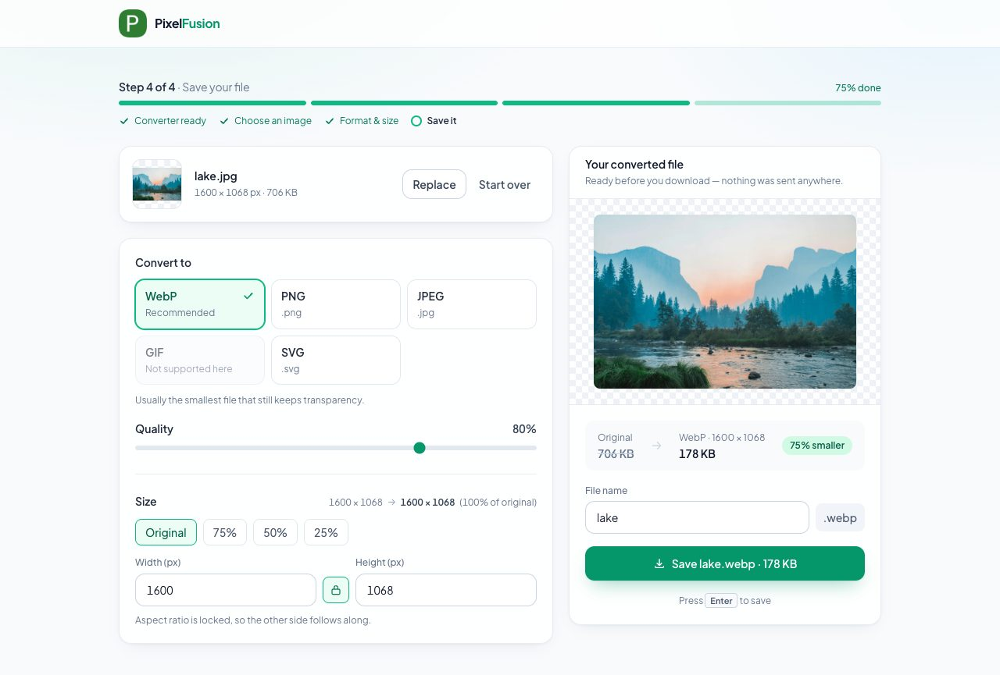
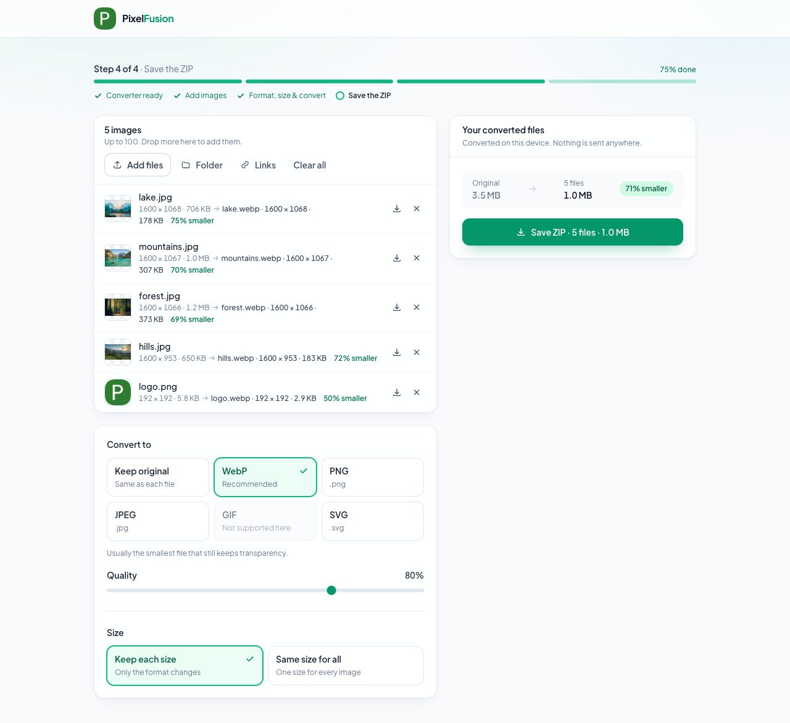

# PixelFusion 🌟

PixelFusion is an amazing image converter app that operates seamlessly within your web browser, all without relying on any external servers! 🖼️

## Screenshots 📸

Check out the live PixelFusion app in action: [Live Link](https://pixelfusion.vercel.app)

**Single image:** the converted file and its exact size are on screen before you save it.

**Bulk conversion:** a batch converted to WebP, each file with its result, ready to save as one ZIP.

## What is PixelFusion? 🚀

PixelFusion is a powerful image conversion tool that empowers you to manipulate and transform your images right from your web browser. With an intuitive and user-friendly interface, it makes the process of converting images a breeze.And the best part? You don't need to rely on any external servers – everything happens right on your device! The only runtime dependency besides React is [client-zip](https://github.com/Touffy/client-zip) (2.6 kB gzipped), which builds the ZIP for bulk downloads and is loaded only when you save one.

## Features 🎉

- **No Server Dependencies**: PixelFusion operates solely within your browser, ensuring your data stays private and secure.

- **User-Friendly Interface**: Our app is designed with simplicity in mind, making it accessible to users of all skill levels.

- **Image Conversion**: Easily convert your images with various options like resizing, cropping, and applying filters.

- **Live Preview**: See the changes in real-time as you adjust your image settings.

- **Load From a Link**: Paste an image address (or up to 100 of them, one per line) instead of picking a file. Pressing ⌘V / Ctrl+V anywhere on the page works too, for copied images as well as links. Your browser downloads the image straight from the site that hosts it, so nothing passes through a server. Some sites forbid other pages from reading their images (CORS); for those, save the image and drop it in instead.

- **Bulk Conversion**: Pick or drop up to 100 images, or a whole folder, and convert them in one go. Choose one output format (or keep each file's own format) and either keep every image's size or give them all one size. Files convert one at a time, a file that fails is marked with the reason while the rest carry on, and everything is saved as a single ZIP. Each file can also be saved on its own.

## How to Contribute 🤝

We welcome contributions to make PixelFusion even better! If you'd like to contribute, please follow these guidelines:

1. **Fork** this repository.

2. **Clone** the forked repository to your local machine.

3. **Create a new branch** for your feature or bug fix.

4. **Make your changes** and ensure that the app still functions correctly.

5. **Commit** your changes with descriptive commit messages.

6. **Push** your changes to your forked repository.

7. Create a **Pull Request** to the main repository, explaining your changes and their purpose.

8. Our team will review your PR and provide feedback or merge it if everything looks good.

9. Thanks for contributing to PixelFusion! 🙌

Upcoming Features* -

- RGBtoPNG
- Cropping
- Filters
